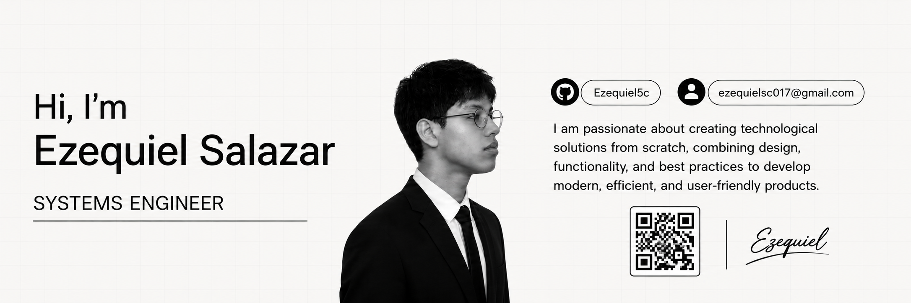
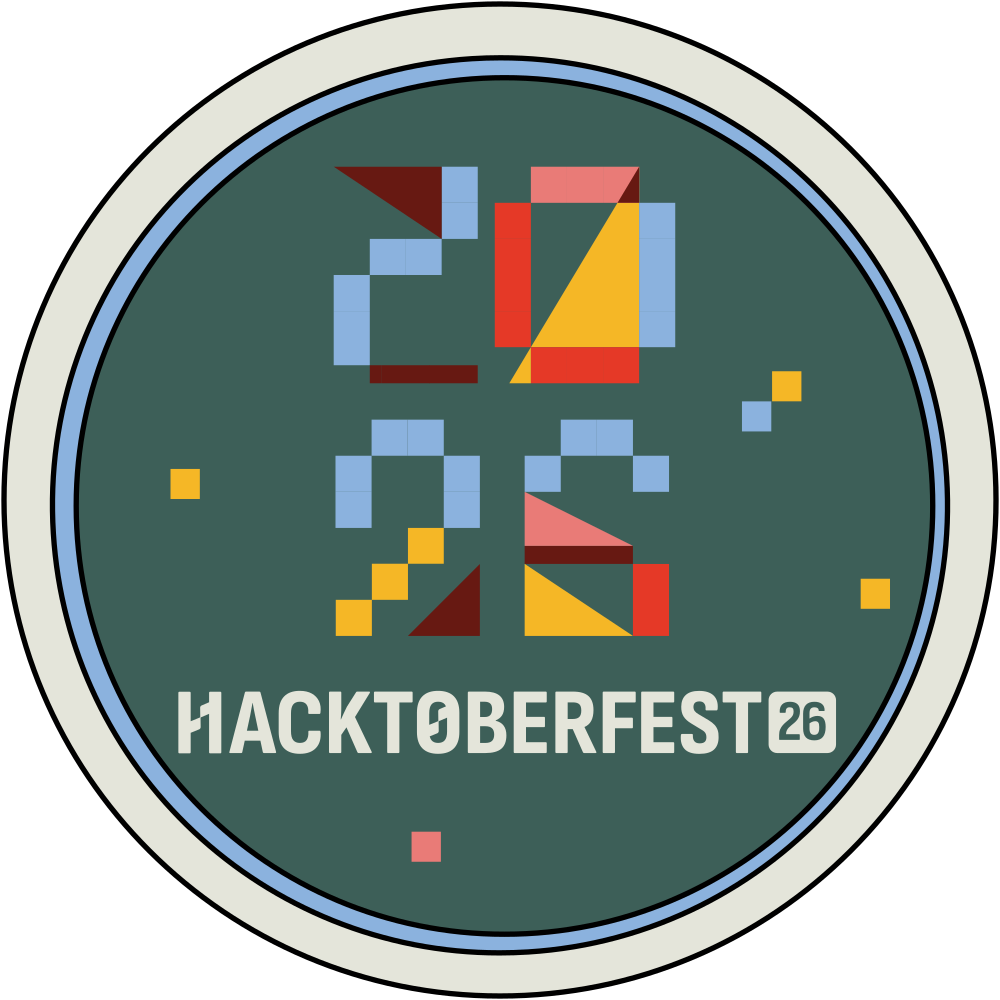
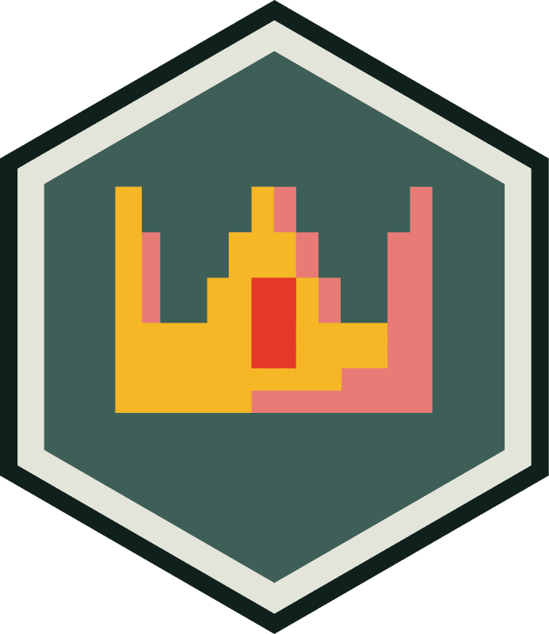

 

 
**FULL STACK DEVELOPER · OPEN SOURCE · TECH ENTHUSIAST**
With great code comes great responsibility.

  

---

### 01. The Origin Story

I'm **Ezequiel**, a Computer Systems Engineering student from Mexico, passionate about building modern web and mobile applications.

I enjoy exploring **AI, cloud technologies, software architecture**, and contributing to open-source communities.

- Building real-world Full Stack applications.
- Learning and experimenting with new technologies.
- Contributing to Open Source and participating in hackathons.

---

### 02. My Tech Arsenal

**Frontend & Mobile**

**Backend & Databases**

**Tools & Cloud**

---

### 03. Across the GitHub-Verse

 

---

### 04. Achievements Unlocked

  

<table>
<tr>
<td align="center" width="170">

 
<b>Hacktoberfest 2026</b>
</td>
<td align="center" width="170">

 
<b>Featured Participant</b>
</td>
</tr>
</table>

---

### 05. Multiverse Badge Collection

---

### 06. Open a Portal

  

  

**WITH GREAT CODE COMES GREAT RESPONSIBILITY.**

