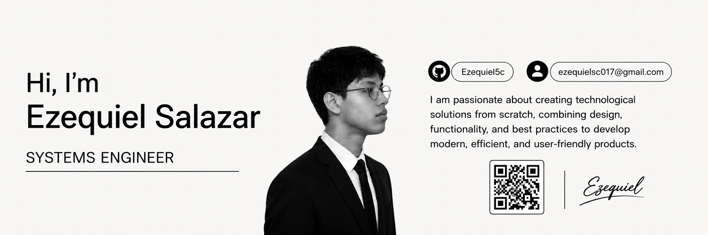
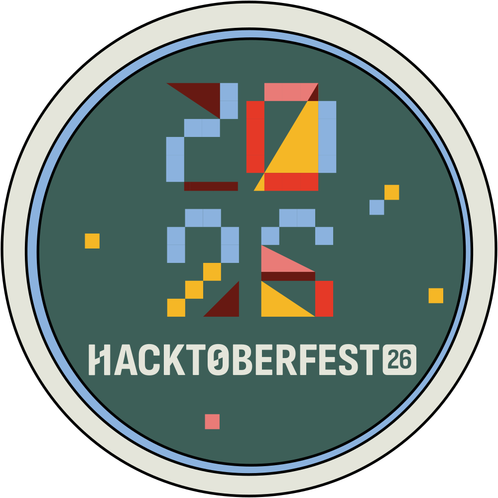
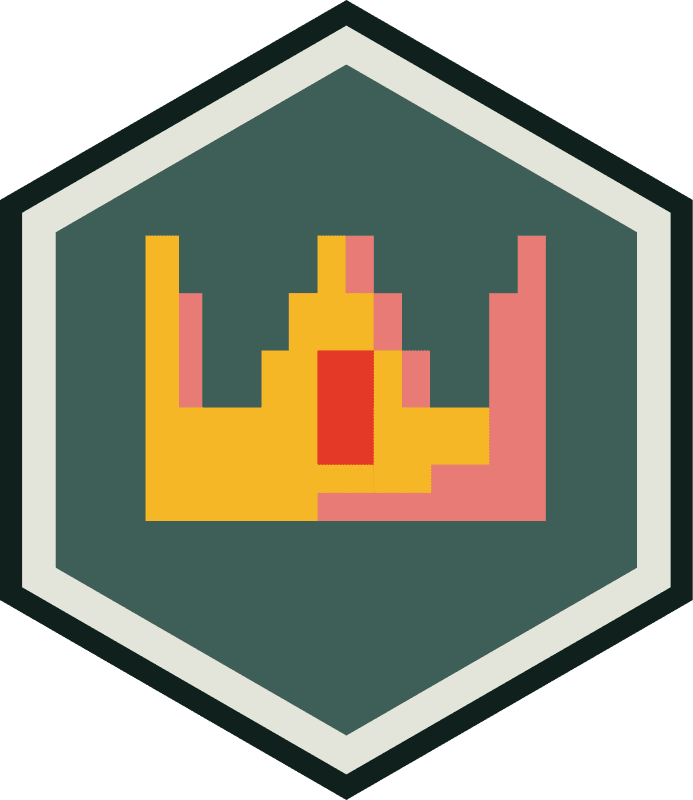

 

 

### Software Developer · Open Source Contributor · Tech Enthusiast

Computer Systems Engineering Student | Mexico
 

  

## 01 / About Me

I'm **Ezequiel Salazar**, a Computer Systems Engineering student and software developer based in Mexico.

I enjoy transforming ideas into functional digital experiences, combining **clean interfaces, scalable architectures, and modern technologies**.

My interests include Full Stack development, mobile applications, artificial intelligence, cloud computing, and open-source software.

- Building web and mobile applications with real-world impact.
- Exploring AI integration and modern backend architectures.
- Contributing to open-source projects and developer communities.
- Participating in hackathons and collaborative challenges.
- Continuously improving my software engineering skills.

> "With great code comes great responsibility."

---
## 02 / Tech Stack

### Frontend Development

 

### Mobile Development

 

### Backend Development

 

### Databases

 

### Development Tools & Cloud

## 03 / Featured Projects

A selection of projects where I explore software engineering, user experience, artificial intelligence, and modern web technologies.
<table>
<tr>
<td width="50%" valign="top">

### EarthTrend NASA

Interactive climate exploration platform featuring 3D Earth visualization and scientific environmental data.

**Tech:** Angular · Three.js · FastAPI · NASA POWER

</td>
<td width="50%" valign="top">

### Jobly

Technology job discovery platform featuring advanced search, filtering, and AI-powered assistance.

**Tech:** Angular · Python · FastAPI · AI

</td>
</tr>

<tr>
<td width="50%" valign="top">

### Collectify

Inventory and business management platform for collectible stores, featuring sales, suppliers, and analytics.

**Tech:** Angular · FastAPI · PostgreSQL · AI

</td>
<td width="50%" valign="top">

### Ruta Viva AI
AI-powered outdoor adventure platform with personalized missions, achievements, and exploration challenges.

**Tech:** Angular · FastAPI · OpenRouter

</td>
</tr>
</table>

## 04 / GitHub Analytics

  

  

---

## 05 / Open Source & Community

I believe software development goes beyond writing code. It's also about **collaboration, knowledge sharing, and contributing to the developer ecosystem**.

My journey includes contributions to open-source projects, participation in developer events, and continuous learning through technical communities.

 

**Communities & Activities**

- Open Source Contributions
- Hacktoberfest
- Major League Hacking — Global Hack Week
- NASA Space Apps Challenge
- Google Developer Groups & DevFest
- DEV Community Challenges

---

## 06 / Achievements & Milestones

  

<table>
<tr>
<td align="center" width="190">

 

**Hacktoberfest 2026**

Open Source Participation

</td>
<td align="center" width="190">

 

**Featured Participant**

Community Recognition

</td>
</tr>
</table>

## 07 / Digital Badge Collection

A collection of digital achievements earned through open-source contributions, developer challenges, technical learning, and community participation.

  

---

## 08 / Let's Connect

### Have an idea? Let's build something great.

I'm always interested in learning opportunities, meaningful collaborations, open-source initiatives, and challenging software projects.

 

  

---

Designed with passion. Built with curiosity. Driven by code.

 

**WITH GREAT CODE COMES GREAT RESPONSIBILITY.**

 

