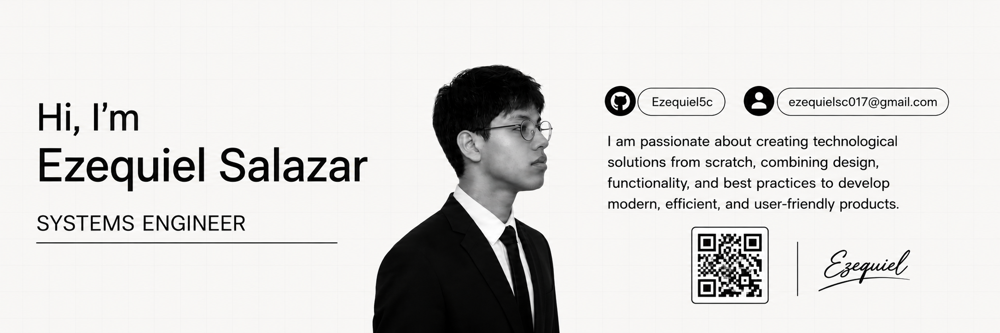
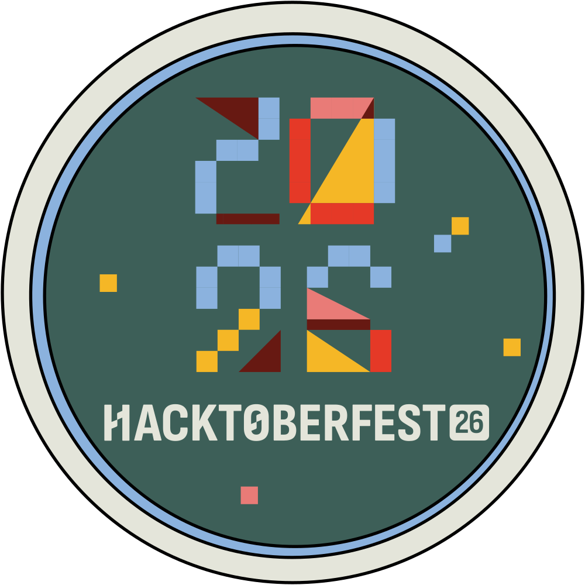
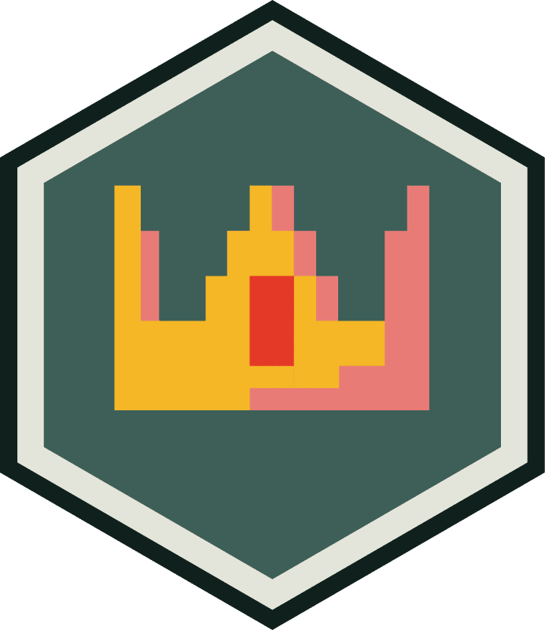

 

  

 

**Computer Systems Engineering Student · Full Stack & Mobile Developer**

*Building meaningful digital experiences, one commit at a time.*

---

## 👨‍💻 About Me

I'm a passionate **Computer Systems Engineering student** from Mexico, focused on creating modern, scalable, and meaningful digital solutions.

I enjoy exploring new technologies, developing web and mobile applications, contributing to open-source projects, and challenging myself through hackathons.

- 🚀 Building modern **Web & Mobile Applications**
- 💻 Working with **Angular, Flutter, React & FastAPI**
- 🌱 Exploring **Artificial Intelligence, Cloud & Software Architecture**
- 🌍 Contributing to **Open Source Communities**
- 🏆 Participating in **Hackathons & Developer Challenges**
- 🎯 Driven by curiosity, innovation, and continuous learning

---

## ⚡ Tech Stack

**Frontend & Mobile Development**

 

  

**Backend & Databases**

 

  

**Tools & Platforms**

 

---

## 📊 GitHub Activity

  

---

## 🏆 GitHub Trophies

---

## 🏅 Hackathons & Achievements

### Global Hack Week · 2026

*Learning, building, collaborating, and turning ideas into real projects.*

Participating in hackathons has been an incredible opportunity to challenge my skills, explore emerging technologies, and connect with developers from around the world.

 

<table>
  <tr>
    <td align="center" width="190">
      
       
      <b>Hacktoberfest 2026</b>
    </td>
    <td align="center" width="190">
      
       
      <b>Featured Achievement</b>
    </td>
  </tr>
</table>

 

  🏆 Hackathon Participant · Open Source · Community Engagement

---

## 🌍 Open Source & Community

I believe that great software is built through collaboration, knowledge sharing, and continuous improvement.

Through open-source contributions, developer communities, and technical challenges, I continue improving my skills while learning from developers around the world.

---

## ✍️ Writing & Sharing on DEV

I share my learning journey, technical discoveries, and experiences as a developer.

 

---

## 🤝 Let's Connect

  

  

**"Never stop learning. Never stop building."**

